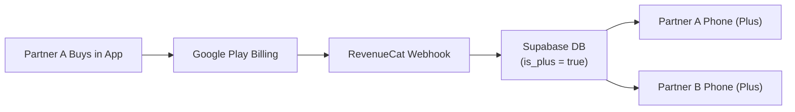
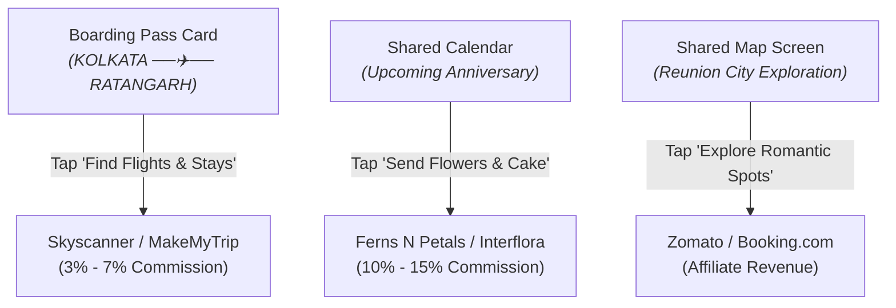

# NextMeet: Complete Monetization Master Strategy & Architecture
**Project:** NextMeet (Intimate Couple Digital Space)  
**Version:** `1.0.38+85`  
**Configuration File:** `Monetize.md`  
**Billing Engine:** RevenueCat (`purchases_flutter`) + Google Play Billing  
**Database Sync:** Supabase (`relationships` & `users` tables)

---

## 1. Executive Summary & Core Monetization Principles

NextMeet is an intimate, private digital sanctuary for couples—especially those navigating long distances. Monetization in this space requires deep emotional trust and delicate craftsmanship.

### 🌟 The 3 Immutable Monetization Principles:
1. **The Golden Couple Rule (Pay Once, Unlocks for Both):**  
   Couples never pay twice. When Partner A subscribes on Android, Partner B (even on an iPhone) automatically unlocks **NextMeet Plus** with zero extra charge. This single selling point doubles subscription conversion rates.
2. **100% Ad-Free Guarantee:**  
   Zero intrusive AdMob banners or video popups. Low-ticket ads pay pennies while completely destroying romantic ambiance and user retention.
3. **Value at Emotional High-Points:**  
   Free users enjoy core pairing, chat, boarding pass countdowns, and daily love notes forever. Paid prompts trigger only at natural milestones: when they fill their photo vault, want custom haptics, or plan reunion travels.

---

## 2. Pillar 1: "NextMeet Plus" Subscriptions (The 80% Core Engine)

Subscriptions provide predictable **Monthly Recurring Revenue (MRR)** and form the foundation of NextMeet's revenue.



### Active Subscription Plans

| Plan | Product ID | Google Play Price (India) | Global Price (USD) | Strategy & Positioning |
| :--- | :--- | :--- | :--- | :--- |
| **Monthly Sanctuary** | `nextmeet_plus_monthly` | **₹49 / month** | **$4.99 / month** | Low-friction entry point for couples testing before a visit. |
| **Annual Sanctuary** | `nextmeet_plus_yearly` | **₹499 / year** | **$29.99 / year** | **Best Value (50% Off)**. Upfront cash flow and 12-month lock-in. |
| **Lifetime Pass** *(Upcoming)* | `nextmeet_plus_lifetime` | **₹1,999 one-time** | **$59.99 one-time** | For couples/students who refuse recurring card subscriptions. |

---

### Free vs. NextMeet+ Feature Matrix

| Feature | Free Tier 🤍 | NextMeet+ (Paid) 💎 | Implementation Status |
| :--- | :---: | :---: | :--- |
| **Secret Photo Vault Storage** | 20 MB | **150 MB+ Unlimited (WebP)** | ✅ Active (`secret_photos_screen.dart`) |
| **Shared Memories Timeline** | 5 Memories | **Unlimited Memories + Frames** | ✅ Active (`memories_screen.dart`) |
| **Shared Map Love Trail** | Standard Line | **Neon Glow, Sanctum Gold & Weather** | ✅ Active (`shared_map_screen.dart`) |
| **Pro-Haptics Vibration Engine** | Basic Pulse | **Heartbeat Wave & Custom Touch Rhythms** | ✅ Active (`haptic_preferences_screen.dart`) |
| **Profile Aesthetics** | Default Ring | **Indigo / Rose Gold Neon Ring + VIP Badge**| ✅ Active (`profile_screen.dart`) |
| **Shared Trip Planner** | 1 Active Trip | **Up to 10 Active Concurrent Trips** | ✅ Active (`cloud_relationship_service.dart`) |
| **Daily Notes & Archives** | Today Only | **Full History & Deep Intimacy Packs** | ✅ Active (`nextmeet_plus_screen.dart`) |
| **Couple Cross-Platform Sync** | Synchronized | **Pay Once for Both Partners** | ✅ Active (`subscription_service.dart`) |

---

## 3. Pillar 2: Virtual Micro-Gifts & Sparks (In-App Microtransactions)

Designed for users who do not want a recurring subscription, but want to make a special romantic gesture on birthdays, anniversaries, or late-night calls.

### Microtransaction Catalog (Non-Consumable & Consumable)

| Digital Product | Price Point | User Experience & Mechanics |
| :--- | :--- | :--- |
| **Midnight Rose Bouquet** | ₹49 / $0.99 | A 3D rose bouquet blooms on the partner's screen accompanied by heartbeat haptics and soft chime audio. |
| **Surprise Screen Fireworks** | ₹29 / $0.99 | Lights up the partner's entire phone screen with a dazzling firework celebration. |
| **Romantic Envelope Wax Seal** | ₹39 / $0.99 | Custom vintage wax-seal animations for Love Notes in Sanctuary. |
| **Printable Reunion Poster (PDF)** | ₹79 / $1.99 | High-res vector export of their flight path, boarding pass, and relationship timeline suitable for physical framing. |

---

## 4. Pillar 3: Reunion Travel & Date Night Affiliates (Passive Commission)

Long-distance couples spend thousands annually on reunion flights, trains, hotel rooms, and physical flowers. NextMeet can earn 3%–15% on these transactions natively:

### Affiliate Integration Touchpoints



1. **Flight & Hotel Booking (3% – 7% Commission):**
   * Placed subtly on the Home Screen Boarding Pass card below the countdown.
   * Auto-populates Partner A's city and Partner B's city directly into Skyscanner / MakeMyTrip / Booking.com deep links.
   * **Estimated Revenue:** ₹300 – ₹1,200 per booked reunion flight/stay.
2. **Anniversary Gift & Flower Delivery (10% – 15% Commission):**
   * Appears in the Calendar screen 3 days prior to an anniversary or birthday.
   * Button: *"Send Midnight Flowers to [Partner Name] 🌸"*.
   * Links directly to local florists (Ferns N Petals, Interflora, Floweraura).
   * **Estimated Revenue:** ₹100 – ₹300 per delivery.

---

## 5. Technical Implementation & Data Pipeline

### Key Configurations:
* **RevenueCat Public Android API Key:** `goog_YDTtQiefCXZrxulXFgTSevALUwk`
* **Entitlement Identifier:** `plus`
* **Monthly Package ID:** `$rc_monthly` ➔ `nextmeet_plus_monthly`
* **Annual Package ID:** `$rc_annual` ➔ `nextmeet_plus_yearly`
* **Service Class:** [`lib/core/services/subscription_service.dart`](file:///d:/Flutter/NextMeet/lib/core/services/subscription_service.dart)
* **Paywall Screen:** [`lib/features/profile/nextmeet_plus_screen.dart`](file:///d:/Flutter/NextMeet/lib/features/profile/nextmeet_plus_screen.dart)

### Supabase Database Schema:
```sql
-- Relationships Table: holds the couple entitlement state
UPDATE public.relationships
SET is_plus = true,
    data = jsonb_set(
        jsonb_set(data, '{premiumPlanType}', '"Annual Sanctuary"'),
        '{premiumRenewalDate}', '"2027-10-17T00:00:00Z"'
    )
WHERE id = :rel_id;

-- Users Table: holds individual member record
UPDATE public.users
SET is_plus = true,
    premium_plan = 'Annual Sanctuary',
    premium_expiry = '2027-10-17T00:00:00Z'
WHERE id IN (:uid1, :uid2);
```

### Media Storage Routing:
* **All Vault Photos & Avatars:** Routed to Supabase Storage bucket `memories` under `$rel_id/private_photos/` and `$rel_id/profiles/`.
* Free tier storage capped at 20MB (`rel.privateSpaceStorageBytes`). NextMeet+ uncaps storage to 150MB+.

---

## 6. Testing & Quality Assurance Protocol

### How to Test Subscriptions for ₹0 (Free) on Device:
1. In **Google Play Console** ➔ **Settings** ➔ **License testing**:
   * Add test Google account email (e.g. `jn.aditya21@gmail.com`).
   * Set *License response* to: `RESPOND_NORMALLY`.
2. Install the app on an Android device logged in with the tester account.
3. Open NextMeet+ Paywall ➔ Tap **Unlock for Both ❤️**.
4. Google Play will present the test payment sheet: *"Test Card, always approves (Free)"*.
5. Complete payment: Supabase immediately updates `is_plus = true` for both partners.
