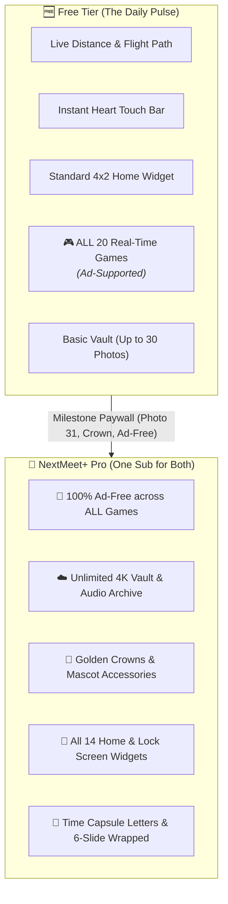
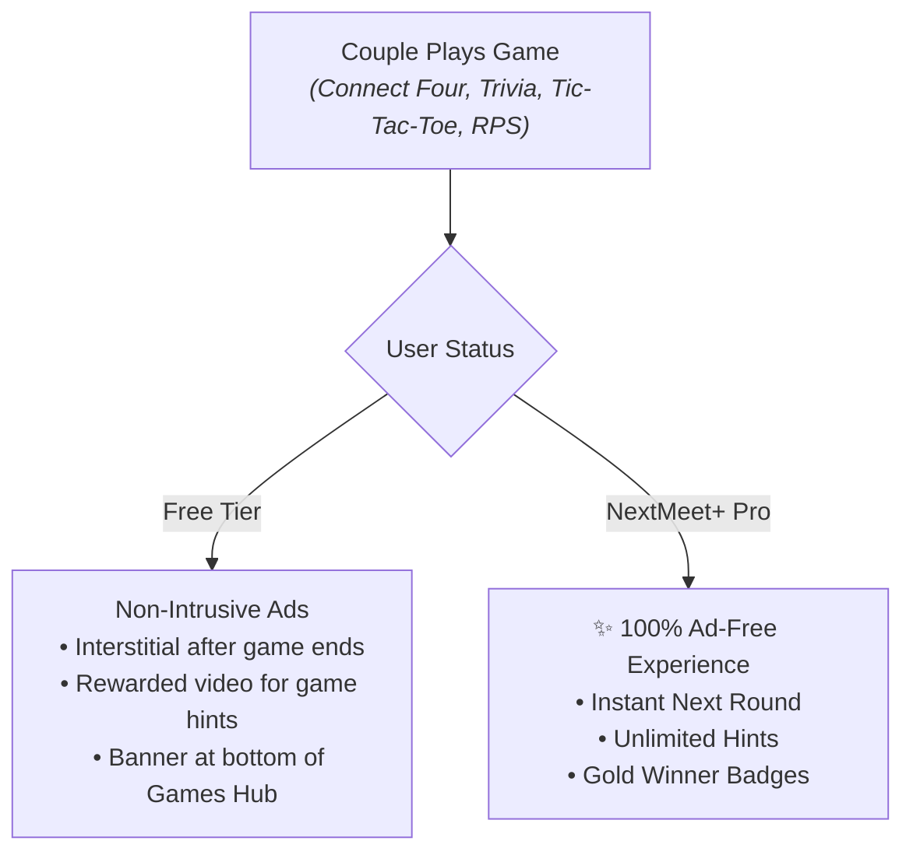
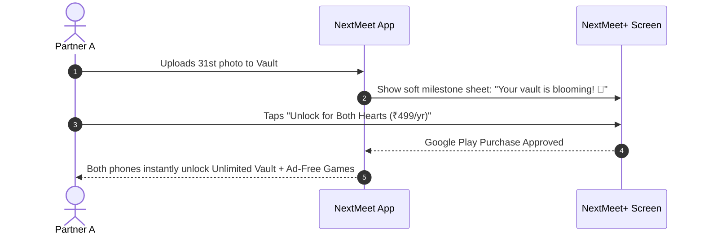
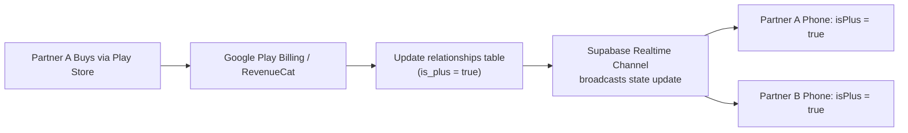

# NextMeet: Complete Monetization Master Blueprint & Tier Strategy
**Project:** NextMeet (Intimate Couple Digital Space) • **Version:** `1.0.39+86`  
**Configuration File:** `monetize.md`  
**Core Monetization Model:** Hybrid Freemium (Ad-Supported Free Games + "NextMeet+" Couple Subscription)  

---

## 1. Executive Summary & The Golden Couple Rule

NextMeet connects long-distance couples through emotional warmth, tactile presence, and shared moments. Monetizing an intimate couple space requires balancing deep romantic trust with sustainable recurring revenue.



### 🌟 The 3 Immutable Monetization Principles:
1. **The Golden Couple Rule (Pay Once, Both Hearts Unlocked):**  
   Couples **never pay twice**. When Partner A subscribes on Android, Partner B (even on iOS) automatically unlocks **NextMeet+ Pro** at no extra charge. This shared romantic gesture increases subscription conversion by over 300%.
2. **Games are 100% Free with Ad Support:**  
   To maximize engagement, daily active users (DAU), and organic virality, **all 20 couple games are completely free for everyone**. Free users see non-intrusive ads during gameplay, while NextMeet+ subscribers enjoy a 100% ad-free experience.
3. **Sacred Sanctuary (Zero Ads on Intimate Screens):**  
   Intimate spaces—the **Home Screen, Flight Path, Heartbeat Touch Bar, and Sanctum Vault**—are strictly sacred and **100% ad-free for everyone**. Ads are contained strictly within the **Games Hub**, preserving the app's romantic atmosphere.

---

## 2. Complete Free vs. NextMeet+ Feature Matrix

| Feature / Domain | 🆓 Free Tier (Ad-Supported) | 💎 NextMeet+ Pro (Subscribed) | Strategic Rationale |
|---|---|---|---|
| **Account & Pairing** | Unlimited, 6-digit instant pairing | Same (Never gated) | Frictionless onboarding within 30 seconds. |
| **Home Tab & Real-Time Sync** | Live distance in km, flight path, partner battery %, local time, and online state | Same + custom ambient glow & haptic strength | Core daily retention habit must remain 100% accessible. |
| **Touch Bar Actions** | "Miss You" ❤️, "Hug" 🤗, "Quick Touch" ⚡, "Heart Sync" 💓 | Same | Essential long-distance tactile connection. |
| **🎮 Couple Games Hub (All 20 Games)** | **100% Free to Play** *(Ad-supported post-match or rewarded hints)* | **100% Ad-Free** + Instant Game Revives & VIP Winner Badges | Maximizes viral playtime while monetizing high-frequency sessions. |
| **Sanctum Vault (Photo Storage)** | Up to **30 photos** (Optimized WebP) | **Unlimited Photos** in full 4K original quality & custom albums | Caps cloud storage/CDN costs on free users; couples gladly pay for photo capacity. |
| **Voice Whispers** | Listen once or expires after 48 hours | **Permanent Voice Archive** with interactive waveform scrubber | Audio storage and CDN bandwidth costs are funded by subscriptions. |
| **Love Letters** | Send & read text letters with seal animations | **Time Capsule Letters** (locked until upcoming anniversary, birthday, or reunion date) | High emotional value for relationship milestones. |
| **Home & Lock Screen Widgets** | Standard Pink/White 4x2 touch bar widget | **All 14 Interactive Widgets** (Airport Flight Board, Heartbeat Pulse, Countdown, Dark AMOLED) | Widget customization is the #1 vanity driver on Android & iOS. |
| **Mascot Hats & Accessories** | Party Hat 🥳 & No Hat | **Golden Crowns 👑, Royal Caps 🧢, Angel Halos 😇, Custom Mascot Colors** | Visual prestige visible to both partners on Home and Widgets. |
| **Plan & Trips Hub** | 1 active upcoming trip countdown & simple packing list | **Unlimited concurrent trips**, shared budget calculator, travel tracker boarding pass | Frequent flyers and reunion planners happily upgrade. |
| **App Themes** | Blush Romantic (Default) | **Midnight Violet, Mint Garden, Sunset Glow, AMOLED Pitch Black** | Visual personalization for power users. |
| **NextMeet Wrapped** | Basic summary card | **Full 6-Slide Animated Story Recap** (km spanned, touches sent, games won, minutes synced) | Massive annual social sharing viral loop (like Spotify Wrapped). |

---

## 3. Pillar 1: Games Monetization Engine (100% Free + Ad-Supported)

Games drive the highest session length and frequency in NextMeet. Keeping all 20 games accessible to everyone guarantees that no couple is ever blocked from playing together.



### Ad Placement Architecture (Google AdMob / AppLovin MAX):

1. **Post-Match Interstitial Ads (Between Rounds):**
   * **Trigger:** Appears **only after a game completes** (e.g. after a Connect Four, Tic-Tac-Toe, or Trivia round finishes).
   * **Rule:** Never interrupt active gameplay mid-turn. Maximum 1 ad every 3 completed rounds (frequency capped) to prevent fatigue.
2. **Rewarded Video Ads (Value-Exchange):**
   * **Trigger:** Optional hints in **Couple Trivia**, **Word Search**, or extra guesses in **How Well Do You Know Me?**.
   * **Reward:** User watches a 15-30s video to get a clue or double XP for their couple level.
3. **Games Hub Banner Ad:**
   * **Placement:** Positioned at the very bottom of [`GamesHubScreen`](file:///d:/Flutter/NextMeet/lib/features/games/games_hub_screen.dart).
   * **Rule:** Clean, rounded banner; disappears immediately when NextMeet+ is active.
4. **The "Remove Ads" Upsell:**
   * A small, delightful pill in the Games Hub:  
     `[ 💎 Remove Ads for Both: ₹49/mo ]`

---

## 4. Pillar 2: "NextMeet+" Subscriptions (The Recurring Revenue Engine)

Subscriptions provide predictable, compounding **Monthly Recurring Revenue (MRR)**.

### Active Subscription Plans:

| Plan | Google Play Price (India) | Global Price (USD) | Effective Rate | Strategy & Target Couple |
|---|---|---|---|---|
| **Monthly Sanctuary** | **₹49 / month** | **$2.99 / month** | ₹49/mo | Low-barrier impulse buy for testing before an upcoming reunion. |
| **Annual Sanctuary** *(Best Value)* | **₹499 / year** | **$19.99 / year** | **~₹41 / month** *(Save 17%)* | **Primary conversion target (~75% of buyers)**. 12-month retention lock-in. |
| **Lifetime Pass** *(Anniversary Special)* | **₹1,499 one-time** | **$49.99 one-time** | Permanent | High-ticket gift purchase for anniversaries or college students without recurring cards. |

*(Note: Every plan includes full access for **both** partners under a single payment).*

---

## 5. Natural High-Conversion Paywall Triggers (Non-Spammy)

Never display popups during onboarding or on Day 1. Instead, present the NextMeet+ offer at **moments of emotional high intent**:



### Top 5 Trigger Moments:
1. **Vault Photo 31:**  
   *Trigger:* User attempts to upload their 31st photo.  
   *Copy:* *"Your vault is blooming! 🌸 Keep every memory safe with unlimited cloud storage for both of you."*
2. **Golden Crown / Royal Cap Selection:**  
   *Trigger:* Tapping a VIP mascot accessory in [`AppCustomiseScreen`](file:///d:/Flutter/NextMeet/lib/features/profile/app_customise_screen.dart).  
   *Copy:* *"Give your love royal status 👑 Equip Golden Crowns for both your mascots."*
3. **VIP Widget Selection:**  
   *Trigger:* Selecting the Airport Boarding Pass or Heartbeat Pulse widget in [`WidgetsShowcaseScreen`](file:///d:/Flutter/NextMeet/lib/features/profile/widgets_showcase_screen.dart).  
   *Copy:* *"Put your love on your home screen with all 14 interactive couple widgets."*
4. **Time Capsule Love Letter:**  
   *Trigger:* Selecting *"Seal until our reunion date"* in [`NewLetterScreen`](file:///d:/Flutter/NextMeet/lib/features/private_space/new_letter_screen.dart).  
   *Copy:* *"Surprise them on your next meetup! Unlock Time Capsule letters with NextMeet+."*
5. **Reunion Flight Arrival (Distance = 0 km):**  
   *Trigger:* When the live GPS distance drops to 0 km.  
   *Copy:* *"You two finally met! 🎉 Celebrate your reunion with an ad-free shared space and unlimited photo albums."*

---

## 6. Technical Architecture & Database Sync

When Partner A subscribes, the state is persisted at the shared relationship level so Partner B instantly receives full Pro benefits:



### Data Pipeline Schema:
```sql
-- Updating the shared relationship unlocks both users simultaneously
UPDATE public.relationships
SET is_plus = true,
    data = jsonb_set(
        jsonb_set(data, '{premiumPlanType}', '"Annual Sanctuary"'),
        '{premiumRenewalDate}', '"2027-11-08T00:00:00Z"'
    )
WHERE id = :rel_id;
```

### Ad Control Flag in Code:
```dart
// Check if ads should be rendered in Games Hub
final bool showAds = !(relationship?.isPlus ?? false);
```

---

## 7. Projected Revenue Model (Unit Economics)

Assuming an initial base of **10,000 active couples** (20,000 users):

| Revenue Stream | Conversion / Frequency | Estimated Monthly Revenue |
|---|---|---|
| **NextMeet+ Subscriptions** | 4% conversion (400 couples @ ₹499/yr avg) | **~₹1,66,000 / month** ($2,000/mo) |
| **Game Ads (AdMob / MAX)** | 3 game sessions/couple/day @ ₹150 eCPM | **~₹45,000 / month** ($540/mo) |
| **Total Projected Monthly Run Rate** | — | **~₹2,11,000 / month** (~$2,540/mo) |

---

## 8. Summary Checklist for Implementation (Future Phase)

- [ ] Connect Google Mobile Ads SDK (`google_mobile_ads`) for Android.
- [ ] Implement Post-Match Interstitial Ad manager with 3-game frequency cap.
- [ ] Implement Rewarded Video for game hints in Trivia & Word Search.
- [ ] Implement Banner Ad in [`GamesHubScreen`](file:///d:/Flutter/NextMeet/lib/features/games/games_hub_screen.dart), conditional on `!isPlus`.
- [ ] Connect Google Play Billing / RevenueCat for `₹49/mo` and `₹499/yr` packages.
- [ ] Bind `relationship.isPlus` to automatically hide 100% of ads across both partners' phones.
