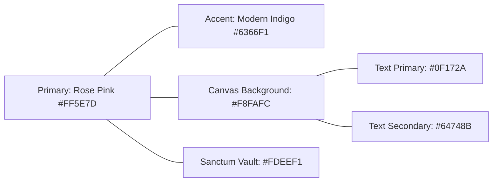

# NextMeet Design System & UI/UX Guidelines
**Project:** NextMeet (Intimate Couple Digital Space) • **Version:** `1.0.38+85`  
**Configuration File:** `design.md`  
**Typography Core:** `GoogleFonts.outfit`  
**Design Philosophy:** Romantic Warmth, Tactile Intimacy, Calm Clarity, and Zero-Friction Ergonomics

---

## 1. Design Philosophy & Romantic Principles

NextMeet is not a utility dashboard or a cold social media feed; it is an intimate digital sanctuary for two people in love. Every screen, animation, and color choice must reflect:
* **Romantic Tactility:** Physical metaphors like digital hand-holding ("Heart Sync"), digital touches, and Polaroid scrapbooks must feel tactile through calibrated haptics and gentle physics.
* **Intimate Delight over System Alerts:** Intimate moments should never be acknowledged with generic system banners (`SnackBar`). Intimate actions trigger floating particle bursts, ambient screen glows, and gentle vibrations.
* **Effortless Thumb Ergonomics:** High-frequency daily actions (Chat, Mood, Touch) must sit comfortably within the natural one-handed thumb zone on modern 6.5"+ mobile screens.
* **Inclusive Readability (WCAG AA):** Intimate emotional text must remain crisp, clear, and high-contrast in direct sunlight, on AMOLED screens, and on budget displays.

---

## 2. Color Palette & Accessibility Tokens



### 2.1 Brand & Emotion Palette
| Token | Hex Value | Purpose & Psychological Impact |
| :--- | :--- | :--- |
| `primary` | `#FF5E7D` | **Signature Love Pink:** Warm, vibrant, affectionate. Used for CTAs, active heart states, and key highlights. |
| `primaryLight` | `#FF859B` | Gradient highlight and badge backgrounds. |
| `primaryDark` | `#E04362` | Pressed button states and active indicators. |
| `accent` | `#6366F1` | **Indigo Companion:** Deep, calming modern accent for partner distinctions and secondary features. |
| `success` | `#10B981` | Emerald green for connected states, matched codes, and synced checks. |
| `error` | `#EF4444` | Soft rose-red for input validation warnings. |
| `warning` | `#F59E0B` | Warm amber for "Streak at Risk" and reminder states. |

### 2.2 Surface & Canvas Architecture
| Token | Hex Value | Usage Rule |
| :--- | :--- | :--- |
| `background` | `#F8FAFC` | **Global Standard Canvas:** Cool, clean slate white used across 95% of screens. |
| `surface` | `#FFFFFF` | Card containers, bottom sheets, and elevated dialogs. |
| `sanctumSurface`| `#FDEEF1` | **Vault Exclusive:** Reserved *exclusively* for the Private Sanctum tab to visually signal a private vault. |
| `divider` | `#E2E8F0` | Subtle hairline borders (`1px`) between list items and card dividers. |

### 2.3 Typography & Contrast Rules (WCAG AA Compliance)
> [!IMPORTANT]
> **STRICT ACCESSIBILITY RULE:**  
> Never render secondary text with low opacity (`alpha: 0.4` or `alpha: 0.5`). On `#F8FAFC`, low opacity drops the contrast ratio below **2.5:1**, making text unreadable. Use solid Slate tints instead:

* **`textPrimary` (`#0F172A` - Slate 900):** Headings, active values, button labels. Contrast ratio: **15.2:1** (AAA).
* **`textSecondary` (`#64748B` - Slate 500):** Subtitles, timestamps, captions, field labels. Contrast ratio: **4.6:1** (Passes WCAG AA).
* **`textMuted` (`#94A3B8` - Slate 400):** Form placeholder hints only.

---

## 3. Typography Scale (`GoogleFonts.outfit`)

```
H1: 32px Bold        ──► "Our World ✨"
H2: 24px Bold        ──► "Next Meeting"
H3: 20px Bold        ──► "Memories & Moments"
Body L: 16px Medium  ──► "How would you like to bridge the gap?"
Body M: 14px Medium  ──► "124 Days Together • Mumbai to London"
Body S: 12px Semi    ──► "SYNCED 2 MINS AGO"
Button: 16px Extra   ──► "ENTER OUR WORLD ✨"
```

### Typography Specification Table
| Style Token | Size | Weight | Tracking (Letter Spacing) | Line Height |
| :--- | :---: | :---: | :---: | :---: |
| `AppTextStyles.h1` | `32px` | `FontWeight.w800` | `-0.5px` | `1.2` |
| `AppTextStyles.h2` | `24px` | `FontWeight.w700` | `-0.3px` | `1.3` |
| `AppTextStyles.h3` | `20px` | `FontWeight.w700` | `0.0px` | `1.3` |
| `AppTextStyles.bodyL` | `16px` | `FontWeight.w500` | `0.0px` | `1.4` |
| `AppTextStyles.bodyM` | `14px` | `FontWeight.w500` | `0.1px` | `1.4` |
| `AppTextStyles.bodyS` | `12px` | `FontWeight.w600` | `0.4px` (Caps: `1.2px`) | `1.3` |
| `AppTextStyles.button` | `16px` | `FontWeight.w800` | `0.5px` | `1.0` |

---

## 4. Spacing, Radii & Elevation Tokens

### 4.1 Spacing Scale (`AppSpacing`)
```dart
static const double xs  = 4.0;
static const double s   = 8.0;
static const double m   = 16.0;
static const double l   = 24.0;
static const double xl  = 32.0;
static const double xxl = 48.0;
```

### 4.2 Corner Radii (`AppRadius`)
* **Small (`12.0`):** Badges, tag chips, reaction pills.
* **Medium (`16.0`):** Text fields, PIN input boxes, secondary buttons.
* **Large (`24.0`):** Standard cards, bottom sheet dialogs, list items.
* **Extra Large (`32.0`):** Hero cards (Next Meeting card, Heart Sync card).
* **Circle (`100.0`):** Floating action buttons, avatar circles, touch buttons.

### 4.3 Shadow Elevation Tokens
```dart
// Soft ambient card elevation
static const List<BoxShadow> softShadow = [
  BoxShadow(color: Color(0x060F172A), blurRadius: 24, offset: Offset(0, 8)),
];

// High-fidelity romantic rose glow for primary actions
static const List<BoxShadow> premiumShadow = [
  BoxShadow(color: Color(0x14FF5E7D), blurRadius: 36, offset: Offset(0, 16), spreadRadius: -8),
  BoxShadow(color: Color(0x060F172A), blurRadius: 10, offset: Offset(0, 4)),
];

// Interactive button press shadow
static const List<BoxShadow> buttonShadow = [
  BoxShadow(color: Color(0x40FF5E7D), blurRadius: 20, offset: Offset(0, 8), spreadRadius: -4),
];
```

---

## 5. Micro-Interactions & Emotional Feedback Patterns

### 5.1 The `FloatingParticleOverlay` (Replacing `SnackBar`)
> [!TIP]
> Intimate couple actions must never summon a grey rectangular system bar that covers the navigation. Instead, spawn lightweight, upward-drifting floating emoji particles:

* **Miss You Action (`miss`):**
  * Spawns 6–8 heart particles (`❤️`, `💖`, `✨`) drifting upward with subtle sinusoidal horizontal sway.
  * Duration: `1200ms`, easing: `Curves.easeOutCubic`.
  * Haptic: Medium double pulse (`VibrationService.medium()`).
* **Virtual Hug Action (`hug`):**
  * Spawns hug emojis (`🤗`, `💕`) + a 300ms ambient rose edge glow around the screen.
  * Haptic: Calibrated long warm hug vibration (`VibrationService.hugVibration()`).
* **Digital Touch (`touch`):**
  * Expanding radial ripple wave centered on the button.
  * Haptic: High-frequency digital pulse.

### 5.2 "Heart Sync" (Holding Hands) Interaction Spec
* **Gesture Filter:** Requires holding for at least **250ms** before engaging. This prevents accidental triggers while the user is vertically scrolling through their feed.
* **Visual Charging Ring:** While holding, an animated circular progress ring fills around the central heart.
* **Partner Detection:**
  * When solo holding: Pulsing rose aura + text: *"Wait for [Partner] to join..."*
  * When simultaneous hold detected: Double heartbeat haptic rhythm every 1.5s + text: *"HOLDING HANDS! ✨"* with dual sparkle bursts.

---

## 6. Ergonomics & One-Handed Thumb Zones

```
┌─────────────────────────────────┐  ▲
│  [Profile]       [NextMeet]     │  │  Top Dead Zone (Hard to reach)
│                                 │  │  Place read-only headers here
│  ┌───────────────────────────┐  │  ▼
│  │   Next Meeting Card       │  │
│  └───────────────────────────┘  │
│                                 │  ▲
│  ┌───────────────────────────┐  │  │  Natural Thumb Zone
│  │  [Miss You]     [Hug]     │  │  │  (Easy one-handed reach)
│  │  [Touch ⚡]               │  │  │  Place daily interaction
│  └───────────────────────────┘  │  │  buttons and Quick Chat here
│                                 │  │
│  [💖 Home] [📸] [🔒] [⚙️] (💬)  │  ▼
└─────────────────────────────────┘
```

* **Quick-Chat Ergonomics:** In addition to the top icon, provide a thumb-friendly Quick Chat button or prominent nav item in the lower half of tall smartphone screens.
* **Touch Target Sizing:** Every interactive icon, button, and avatar has a minimum hit target of **44x44 dp** to eliminate mis-taps.

---

## 7. Component Library Specifications

### 7.1 Primary Action Button (`PrimaryButton`)
* **Height:** `54dp`
* **Border Radius:** `AppRadius.m` (`16dp`)
* **Background:** `LinearGradient(colors: [Color(0xFFFF5E7D), Color(0xFFFF3D68)])`
* **Typography:** `AppTextStyles.button` (White, 16px, Extra-Bold)
* **Loading State:** `CircularProgressIndicator(strokeWidth: 2.5, color: Colors.white)`

### 7.2 PIN Input Theme (`Pinput`)
* **Box Size:** Width `48dp`, Height `54dp`
* **Border:** `1.5dp` solid `#E2E8F0` (Default), `#FF5E7D` (Focused)
* **Fill:** `#FFFFFF` (Surface)
* **Text Style:** `AppTextStyles.h2` (22px, Bold, `#FF5E7D`)
* **Haptics:** Light impact on every digit entry.

### 7.3 Unpaired State Badges
* When a user is not yet paired with a partner, navigation tabs for **Memories** and **Sanctuary** display a clean lock badge:
  * Icon: `Icons.lock_rounded` (Size `12dp`, Color: `#94A3B8`).
  * Behavior: Tapping displays a warm invitation card encouraging the user to share their love code.
