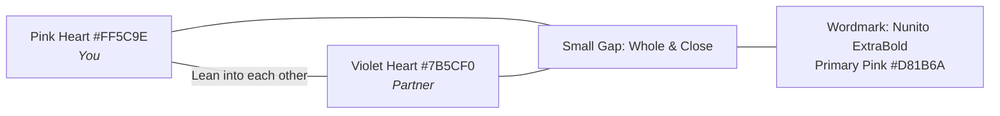

# NextMeet Design System & UI/UX Specifications
**Project:** NextMeet (Intimate Couple Digital Space) • **Version:** `1.1.0`  
**Configuration File:** `design.md`  
**Design Reference:** `NextMeet Redesign.pdf` (86 Pages) & `NextMeet-logo/`  
**Typography Core:** `GoogleFonts.nunito` (Weights: 600 SemiBold & 800 ExtraBold)  
**Design Philosophy:** Modern Flat, Cute and Clean, Zero Elevation, Border-Structured Tactility, Romantic Warmth

---

## 1. Brand Identity & Mascot Foundations



* **The Two Hearts Concept:** Two hearts lean into each other. Pink is you, violet is your partner. A small deliberate gap keeps both whole, just like two people who are far apart and close at heart.
* **Alternate Mascot Colors:** Butter (`#FFD66B`) and Mint (`#6FCFA0`) for custom looks/themes.
* **Mascot Sizes:** `24px` (inline/badges), `40px` (avatars/chips), `64px` (cards/prompts), `96px` (hero headers/milestones).
* **Mascot Accessories:** None, Party Hat, Cap, Golden Crown (unlocked via couple levels or NextMeet+).
* **Wordmark:** *Nunito ExtraBold*, converted to outlines in vector assets. Main brand color: `#D81B6A`.

---

## 2. Core Design Principles

1. **Flat & Clean:** Solid colour fills, **1.5px borders** (`#F8D8E6`), **no drop shadows**, and **no gradients**.
2. **Cute, Not Childish:** Friendly rounded shapes, sweet expressive mascots, clean typography, and tactile micro-interactions.
3. **Two Hearts Semantics:** Pink (`#FF5C9E` / `#D81B6A`) is always **You**; Violet (`#7B5CF0`) is always **Partner**.
4. **Warm and Close:** Short heartfelt copy, big prominent numbers, soft tints.
5. **Tight and Tidy:** `16px` page horizontal padding, `10px` card gaps, `12px` section gaps.

---

## 3. Complete Color System Tokens

### 3.1 Brand & You
| Token Name | Hex Value | Flutter Constant | Usage |
| :--- | :--- | :--- | :--- |
| **Primary** | `#D81B6A` | `AppColors.primary` | Main brand color, primary CTAs, active highlights |
| **Primary Dark** | `#B0145A` | `AppColors.primaryDark` | Pressed button states, high contrast emphasis |
| **You** | `#FF5C9E` | `AppColors.you` | Your mascot heart, your action bubbles & chips |
| **Pink Light** | `#FFC2D9` | `AppColors.pinkLight` | Secondary action backgrounds, tag fills |
| **Pink Soft** | `#FFE0ED` | `AppColors.pinkSoft` | Soft button backgrounds, card highlights |
| **Background (Blush)** | `#FFF4F8` | `AppColors.background` | Global app canvas background |

### 3.2 Partner & Connection
| Token Name | Hex Value | Flutter Constant | Usage |
| :--- | :--- | :--- | :--- |
| **Partner** | `#7B5CF0` | `AppColors.partner` | Partner mascot heart, partner cards & indicators |
| **Partner Light** | `#9B87F5` | `AppColors.partnerLight` | Partner accent highlights, secondary pills |
| **Partner Tint** | `#C9B8FF` | `AppColors.partnerTint` | Partner soft tag borders and backgrounds |
| **Partner Soft** | `#EDE4FF` | `AppColors.partnerSoft` | Partner speech bubbles, quote containers |
| **Partner Text** | `#4B3A8C` | `AppColors.partnerText` | High-contrast readable text on partner soft surfaces |

### 3.3 Accents
| Token Name | Hex Value | Flutter Constant | Usage |
| :--- | :--- | :--- | :--- |
| **Butter** | `#FFD66B` | `AppColors.butter` | Reverse wordmark accent, streaks, trophies, stars |
| **Butter Soft** | `#FFE7A3` | `AppColors.butterSoft` | Warm streak cards, celebration banners |
| **Butter Text** | `#7A5200` | `AppColors.butterText` | High-contrast text on butter backgrounds |
| **Mint** | `#6FCFA0` | `AppColors.mint` | Success confirmations, connected states, checkmarks |
| **Mint Soft** | `#E3F6EC` | `AppColors.mintSoft` | Success containers, active status chips |
| **Mint Text** | `#1F7A4F` | `AppColors.mintText` | High-contrast text on mint surfaces |
| **Blue** | `#3F5FA8` | `AppColors.blue` | Travel indicators, flights, map flight lines |
| **Coral** | `#FF8A6B` | `AppColors.coral` | Sunset tags, warmth indicators |

### 3.4 Neutrals & Structure
| Token Name | Hex Value | Flutter Constant | Usage |
| :--- | :--- | :--- | :--- |
| **Ink** | `#2B1B26` | `AppColors.ink` | Primary headings, dark buttons, wordmark text |
| **Muted** | `#7A6672` | `AppColors.muted` | Secondary descriptions, timestamps, inactive icons |
| **Border** | `#F8D8E6` | `AppColors.border` | Standard 1.5px card & input borders |
| **Border Strong** | `#E7B9CE` | `AppColors.borderStrong` | Focused containers, active selected chips |
| **Card (White)** | `#FFFFFF` | `AppColors.card` | Elevated card surfaces and sheets |
| **Danger** | `#D13A4F` | `AppColors.danger` | Error states, cancel & unpair buttons |

---

## 4. Typography Scale (`GoogleFonts.nunito`)

| Style Token | Size | Weight | Tracking | Flutter Specification | Example Usage |
| :--- | :---: | :---: | :---: | :--- | :--- |
| **Display** | `32px` | `800` (ExtraBold) | `-0.5px` | `AppTypography.display` | "Hello, you", "1000 days" |
| **Title 1** | `26px` | `800` (ExtraBold) | `-0.3px` | `AppTypography.title1` | "You are connected!", "Plan a trip" |
| **Title 2** | `20px` | `800` (ExtraBold) | `-0.2px` | `AppTypography.title2` | "Reunion in Chennai", "Tic-tac-toe" |
| **Heading** | `17px` | `800` (ExtraBold) | `0.0px` | `AppTypography.heading` | "Next meetup", "Our memories" |
| **Body** | `15px` | `600` (SemiBold) | `0.0px` | `AppTypography.body` | "A private space for just the two of you." |
| **Label** | `12px` | `800` (ExtraBold) | `1.0px` | `AppTypography.label` | "TOGETHER SINCE", "NEXT TRIP" (Uppercase) |
| **Caption** | `13px` | `600` (SemiBold) | `0.0px` | `AppTypography.caption` | "Rahul felt it 2 min ago", "Online now" |

---

## 5. Spacing, Radii & Surface Architecture

### 5.1 Spacing Tokens (`AppSpacing`)
* **Page Padding:** `16.0` (Consistent left/right padding across all screens)
* **Card Gap:** `10.0` (Between adjacent cards or list rows)
* **Section Gap:** `12.0` (Between headers and content blocks)
* **Item Spacing Scale:** `4.0` (xs), `8.0` (s), `10.0` (m), `16.0` (l), `24.0` (xl), `32.0` (xxl)

### 5.2 Corner Radii Tokens (`AppRadius`)
* **Badge / Chip:** `12.0`
* **Text Input:** `18.0`
* **Standard Card:** `22.0`
* **Hero Banner Card:** `28.0`
* **Button Pill:** `27.0` (Full rounded pill shape for 54px buttons)
* **Circle / Mascot:** `100.0`

### 5.3 Elevation & Border Rules (Strict Flat Protocol)
> [!IMPORTANT]
> **ZERO SHADOWS OR GRADIENTS:**  
> The redesign strictly eliminates standard box shadows and gradients.  
> Every card is built with:
> - Background: `AppColors.card` (`#FFFFFF`) or tinted container
> - Border: `Border.all(color: AppColors.border, width: 1.5)` (`#F8D8E6`)
> - Active/Focus: `Border.all(color: AppColors.primary, width: 2.0)` (`#D81B6A`)
> - Elevation: `0.0` (Always flat)

---

## 6. Global Navigation Hierarchy

The redesigned app features a unified **5-Tab Bottom Navigation Bar**:
```
┌────────────────────────────────────────────────────────┐
│  [🏠 Home]    [🎮 Games]    [📅 Plan]    [🔒 Vault]    [👤 Me]  │
└────────────────────────────────────────────────────────┘
```
1. **Home (`HomeScreen`):** Partner hero status card (battery %, online status, timezone difference), 3-metric quick chips, distance flight arc, Heartbeat sync button, recent memories carousel.
2. **Games (`GamesHubScreen`):** Couple challenge hub (Tic-Tac-Toe, Quiz, Truth or Dare, Draw Together, Memory Match, Would You Rather), Level & XP bar, Badges.
3. **Plan (`PlanHubScreen`):** Next meetup countdown, weekly calendar strip, upcoming events, Bucket List, and full Trips Hub (Itinerary, Packing, Budget/Expense split, Flight tracker).
4. **Vault (`SanctumVaultScreen`):** Encrypted private space with PIN / biometric unlock, Secret photos, Love Letters (sealed & scheduled), Voice Whispers player & recorder.
5. **Me (`MeProfileScreen`):** Couple overview, days together, streak, NextMeet+ paywall & management, profile editor, partner details, haptics, quiet hours, app customizer (hats & themes).

---

## 7. Component Library Blueprint

### 7.1 Buttons (`PrimaryButton`, `SoftButton`, `DarkButton`)
* **Primary:** Pill shape (height `54dp`, radius `27dp`), filled `#D81B6A`, white Nunito 800 text.
* **Soft:** Pill shape, filled `#FFE0ED`, text `#D81B6A`.
* **Dark:** Pill shape, filled `#2B1B26`, text `#FFFFFF`.
* **White:** Pill shape, filled `#FFFFFF`, border `1.5px #F8D8E6`, text `#2B1B26`.
* **Disabled:** Fill `#F5EEF2`, text `#BBAAB5`.

### 7.2 Form Inputs (`AppTextInput`, `AppPinInput`)
* **Container:** Height `54dp`, fill `#FFFFFF`, border `1.5px #F8D8E6`, radius `18dp`.
* **Focus State:** Border `2.0px #D81B6A`.
* **Error State:** Border `1.5px #D13A4F`, helper text in `#D13A4F`.
* **PIN Input (6-digit / 4-digit):** Square-rounded boxes `50x54dp`, radius `14dp`, border `1.5px #F8D8E6`, bold text `22px #D81B6A`.

### 7.3 Cards & Chips
* **Hero Card:** Filled `#D81B6A` or `#7B5CF0` or `#FFF4F8`, radius `28dp`, border `1.5px`.
* **Metric Card:** Filled `#FFFFFF`, radius `22dp`, border `1.5px #F8D8E6`, displays large bold number + uppercase label.
* **Chips / Tags:** Pill shape (height `32dp`, radius `16dp`), border `1.0px`, soft tint fills (`#FFE0ED` for you, `#EDE4FF` for partner, `#FFE7A3` for streak).
* **Empty State Card:** Filled `#FFF4F8`, radius `22dp`, cute heart mascot illustration, one clear action CTA.

### 7.4 Micro-Interactions & Haptics
* **Heartbeat Sync:** Dual hold detector with live ECG pulse wave, synchronized haptic rhythm (`VibrationService`), and live dual BPM display.
* **Virtual Hug & Miss You:** Spawn lightweight floating heart particles drifting upward with subtle sine wave oscillation.
* **Custom Numeric Keypad:** Tactile haptic click on each numeric button press with instant visual bounce.
