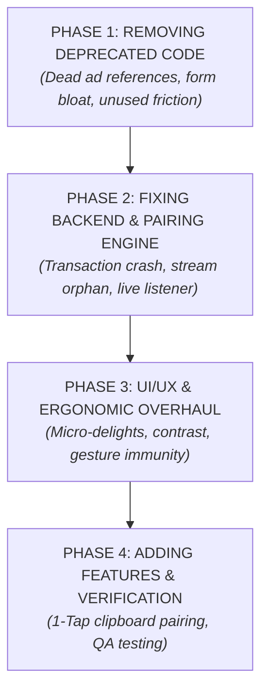

# NextMeet: Phase & Step-Wise Execution Master Plan
**Project:** NextMeet (Intimate Couple Digital Space) • **Version:** `1.0.38+85`  
**Stack:** Flutter 3.10+ / Dart 3 • Firebase (Auth, Firestore, Cloud Messaging, Cloud Storage)  
**Execution Strategy:** Strict Sequential Order — `PHASE 1 (Remove)` ➔ `PHASE 2 (Fix Backend & Pairing)` ➔ `PHASE 3 (UI/UX Polish)` ➔ `PHASE 4 (Add Features & Verification)`

---

## 🧭 Master Phase Flowchart



---

## 🛑 PHASE 1: REMOVING DEPRECATED & FRAGILE CODE
*Goal: Remove all low-quality, cheap ad mechanics, redundant form inputs, and fragile code paths that bloat the app and distract couples.*

### Step 1.1: Remove All AdMob & Banner Ad Remnants
* **Target Files:**
  * [`lib/features/home/home_screen.dart`](file:///d:/Flutter/NextMeet/lib/features/home/home_screen.dart)
  * [`lib/features/home/chat_screen.dart`](file:///d:/Flutter/NextMeet/lib/features/home/chat_screen.dart)
  * [`lib/widgets/banner_ad_widget.dart`](file:///d:/Flutter/NextMeet/lib/widgets/banner_ad_widget.dart)
* **Actions:**
  1. Remove `import '../../widgets/banner_ad_widget.dart';` from `home_screen.dart` and `chat_screen.dart`.
  2. Remove any `<BannerAdWidget>` elements from the widget trees.
  3. Mark `banner_ad_widget.dart` as deprecated or clean it up safely without breaking imports.
* **Acceptance Criteria:**
  * Zero references to AdMob / Banner widgets in the home and chat screens.
  * `flutter analyze` passes with 0 errors.

### Step 1.2: Remove Mandatory Onboarding City Search Roadblocks
* **Target Files:**
  * [`lib/features/onboarding/create_couple_screen.dart`](file:///d:/Flutter/NextMeet/lib/features/onboarding/create_couple_screen.dart)
  * [`lib/features/onboarding/join_couple_screen.dart`](file:///d:/Flutter/NextMeet/lib/features/onboarding/join_couple_screen.dart)
* **Actions:**
  1. In `create_couple_screen.dart`, make city and anniversary selections non-blocking (default to device location or 'Our City' if skipped).
  2. In `join_couple_screen.dart`, remove the mandatory requirement for Partner B to select a city before joining. The 6-digit PIN must be the only requirement to pair.
* **Acceptance Criteria:**
  * Partner B can join by entering only the 6-digit code.
  * No blocking geocoding/Nominatim search delays during initial pairing.

### Step 1.3: Eliminate System SnackBar Anti-Patterns for Couple Interactions
* **Target File:**
  * [`lib/features/home/home_screen.dart`](file:///d:/Flutter/NextMeet/lib/features/home/home_screen.dart#L182-L199)
* **Actions:**
  1. Deprecate `ScaffoldMessenger.of(context).showSnackBar(...)` inside `_handleInteraction(...)`.
  2. Remove snackbar triggers on "Miss You", "Hug", and "Touch" actions.
* **Acceptance Criteria:**
  * Tapping couple interactions does not summon grey/pink rectangular snackbar banners over the bottom navigation bar.

---

## ⚙️ PHASE 2: FIXING BACKEND & PAIRING ENGINE (Eliminating the 90% Drop-off)
*Goal: Fix the atomic transaction failure, resolve the orphaned relationship query trap, and add live reactive pairing listeners.*

### Step 2.1: Decouple Metrics & Non-Critical Writes from `joinJourney` Transaction
* **Target File:**
  * [`lib/core/services/cloud_relationship_service.dart`](file:///d:/Flutter/NextMeet/lib/core/services/cloud_relationship_service.dart#L229-L302)
* **Actions:**
  1. Refactor `joinJourney()`:
     * Keep **strictly** atomic updates inside `_firestore.runTransaction`:
       - Read `invites.doc(code)`
       - Read `relationships.doc(relId)`
       - Update `relationships.doc(relId)` with `uid2`, `uids: [creatorUid, currentUid]`, `status: 'active'`
       - Update `invites.doc(code)` with `status: 'accepted'`
     * Move `system_stats` increment and `pending_relationships.delete()` **outside** the transaction inside an isolated `try/catch` block.
* **Acceptance Criteria:**
  * Any regular, authenticated user joining a journey connects successfully without throwing `[cloud_firestore/permission-denied]`.

### Step 2.2: Update Firestore Security Rules for App Consistency
* **Target File:**
  * [`firestore.rules`](file:///d:/Flutter/NextMeet/firestore.rules)
* **Actions:**
  1. Add explicit permissions for `pending_relationships` and `accepted_relationships`:
     ```javascript
     match /pending_relationships/{relId} {
       allow read, write: if isAuthenticated();
     }
     match /accepted_relationships/{relId} {
       allow read, write: if isAuthenticated();
     }
     ```
  2. Permit authenticated users to increment non-sensitive operational counters in `system_stats`.
* **Acceptance Criteria:**
  * Firestore rules permit couple state transitions for all authenticated partners.

### Step 2.3: Prioritize Active Relationships in `streamRelationship()`
* **Target File:**
  * [`lib/core/services/cloud_relationship_service.dart`](file:///d:/Flutter/NextMeet/lib/core/services/cloud_relationship_service.dart#L311-L317)
* **Actions:**
  1. Replace `_relationships.where('uids', arrayContains: _currentUid).limit(1)` with a deterministic in-memory filter:
     ```dart
     Stream<RelationshipModel?> streamRelationship() {
       if (_currentUid == null) return Stream.value(null);
       return _relationships
           .where('uids', arrayContains: _currentUid)
           .snapshots()
           .map((snapshot) {
         if (snapshot.docs.isEmpty) return null;
         // Prioritize active relationship over orphaned waiting documents
         final activeDoc = snapshot.docs.cast<QueryDocumentSnapshot?>().firstWhere(
           (d) => (d?.data() as Map<String, dynamic>?)?['status'] == 'active',
           orElse: () => null,
         );
         final target = activeDoc ?? snapshot.docs.first;
         return RelationshipModel.fromFirestore(target.data() as Map<String, dynamic>, id: target.id);
       });
     }
     ```
  2. In `joinJourney()`, clean up any abandoned waiting relationship where `uid1 == _currentUid` to prevent database clutter.
* **Acceptance Criteria:**
  * If a user previously created a test journey, joining another journey correctly switches them to the `active` relationship instead of leaving them trapped in "Waiting for Partner".

### Step 2.4: Implement Real-Time Live Pairing Listener on `CreateCoupleScreen`
* **Target File:**
  * [`lib/features/onboarding/create_couple_screen.dart`](file:///d:/Flutter/NextMeet/lib/features/onboarding/create_couple_screen.dart)
* **Actions:**
  1. Add a `StreamSubscription<DocumentSnapshot>? _relSubscription;` to `_CreateCoupleScreenState`.
  2. Once `createJourney` completes and returns the relationship ID:
     ```dart
     _relSubscription = FirebaseFirestore.instance
         .collection('relationships')
         .doc(createdRelId)
         .snapshots()
         .listen((snapshot) {
       if (!snapshot.exists || !mounted) return;
       final data = snapshot.data();
       if (data?['status'] == 'active' && data?['uid2'] != null) {
         _relSubscription?.cancel();
         VibrationService.success();
         Navigator.pushAndRemoveUntil(
           context,
           MaterialPageRoute(builder: (context) => const ConnectionSuccessScreen()),
           (route) => false,
         );
       }
     });
     ```
  3. Ensure `_relSubscription?.cancel()` is properly called in `dispose()`.
* **Acceptance Criteria:**
  * When Partner B joins, Partner A's screen automatically vibrates and transitions to `ConnectionSuccessScreen` without needing to tap any button.

---

## 🎨 PHASE 3: SENIOR UI/UX & ERGONOMIC OVERHAUL
*Goal: Elevate the app into a premium, intimate consumer experience with seamless touch ergonomics, romantic micro-animations, and accessible contrast.*

### Step 3.1: Replace SnackBars with Floating Reaction Micro-Delights
* **Target File:**
  * [`lib/features/home/home_screen.dart`](file:///d:/Flutter/NextMeet/lib/features/home/home_screen.dart)
* **Actions:**
  1. Build a lightweight overlay animation (`FloatingParticleOverlay`):
     * When "Miss You" is tapped: 6–8 heart emojis (`❤️`, `💖`, `✨`) float gently upward from the button and fade over 1.2s.
     * When "Hug" is tapped: Screen border displays a warm ambient glow + rhythmic haptic pulse.
     * When "Touch" is tapped: Button displays an expanding radial ripple wave.
  2. Ensure the overlay does not block touches or obscure the bottom navigation bar.
* **Acceptance Criteria:**
  * Zero system snackbars on couple interactions.
  * Smooth 60fps animations with zero jank.

### Step 3.2: Heart Sync (Holding Hands) Gesture Disambiguation & Visual Progress
* **Target File:**
  * [`lib/features/home/home_screen.dart`](file:///d:/Flutter/NextMeet/lib/features/home/home_screen.dart#L1228-L1355)
* **Actions:**
  1. Add a 250ms hold-delay filter to prevent vertical scrolling from accidentally triggering the sync pulse.
  2. Wrap the Heart icon with an animated progress ring that dynamically fills during the hold.
  3. Increase instruction label font size from 10px to 13px (`AppTextStyles.bodyM`) with WCAG-compliant high contrast.
* **Acceptance Criteria:**
  * Scrolling past the Heart Sync card never triggers accidental pulses.
  * Clear visual feedback during active press.

### Step 3.3: Chat Discoverability & Thumb-Zone Ergonomics
* **Target Files:**
  * [`lib/features/home/home_screen.dart`](file:///d:/Flutter/NextMeet/lib/features/home/home_screen.dart)
  * [`lib/features/home/main_navigation_screen.dart`](file:///d:/Flutter/NextMeet/lib/features/home/main_navigation_screen.dart)
* **Actions:**
  1. Add a floating, ergonomic Quick-Chat pill at the bottom-right corner of `HomeScreen` with an unread badge indicator.
  2. Retain the top header chat icon as a secondary access point.
* **Acceptance Criteria:**
  * Chat is reachable with one thumb on devices with 6.5"+ screens.

### Step 3.4: Typography & Contrast Standardization (WCAG AA Compliance)
* **Target Files:**
  * [`lib/core/constants.dart`](file:///d:/Flutter/NextMeet/lib/core/constants.dart)
  * [`lib/core/theme.dart`](file:///d:/Flutter/NextMeet/lib/core/theme.dart)
* **Actions:**
  1. Replace low-contrast muted colors (e.g. `AppColors.textSecondary.withValues(alpha: 0.4)`) with solid slate tints (`#64748B`, `#475569`).
  2. Ensure all body, label, and timestamp text achieves at least a 4.5:1 contrast ratio against `#F8FAFC`.
  3. Unify scaffold background colors: `#F8FAFC` across main screens, reserving `#FDEEF1` exclusively for the Private Sanctum tab.
* **Acceptance Criteria:**
  * All text is legible in direct sunlight and meets WCAG AA standards.

### Step 3.5: Contextual Guard States for Unpaired Users in Bottom Navigation
* **Target Files:**
  * [`lib/features/home/main_navigation_screen.dart`](file:///d:/Flutter/NextMeet/lib/features/home/main_navigation_screen.dart)
  * [`lib/features/home/memories_screen.dart`](file:///d:/Flutter/NextMeet/lib/features/home/memories_screen.dart)
  * [`lib/features/home/sanctuary_tab.dart`](file:///d:/Flutter/NextMeet/lib/features/home/sanctuary_tab.dart)
* **Actions:**
  1. When unpaired or in waiting state, show a subtle lock indicator on the **Memories** and **Sanctuary** tabs.
  2. Tapping either tab renders an encouraging, actionable card: *"Unlock shared memories as soon as your partner joins!"* with a direct "Share Love Code" button.
* **Acceptance Criteria:**
  * Zero blank screens or infinite circular spinners for unpaired users.

---

## 🚀 PHASE 4: ADDING FEATURES & VERIFICATION
*Goal: Implement frictionless 1-tap onboarding, clipboard auto-detection, and verify full codebase health.*

### Step 4.1: Clipboard Invite Code Auto-Detection on Launch
* **Target Files:**
  * [`lib/features/onboarding/splash_screen.dart`](file:///d:/Flutter/NextMeet/lib/features/onboarding/splash_screen.dart)
  * [`lib/features/auth/login_screen.dart`](file:///d:/Flutter/NextMeet/lib/features/auth/login_screen.dart)
  * [`lib/features/onboarding/setup_couple_screen.dart`](file:///d:/Flutter/NextMeet/lib/features/onboarding/setup_couple_screen.dart)
* **Actions:**
  1. On app launch / resume, inspect `Clipboard.getData(Clipboard.kTextPlain)` for 6-digit regex pattern `r'\b\d{6}\b'`.
  2. If code is found:
     * On `LoginScreen`: Show banner: *"❤️ Partner invite detected! Sign in to connect automatically."*
     * On `SetupCoupleScreen`: Pre-highlight "Connect Heart" and pre-fill the PIN in `JoinCoupleScreen`.
* **Acceptance Criteria:**
  * Invited partners who copy their code from WhatsApp are automatically guided to connect in 1 tap.

### Step 4.2: Hierarchy Redesign on `SetupCoupleScreen`
* **Target File:**
  * [`lib/features/onboarding/setup_couple_screen.dart`](file:///d:/Flutter/NextMeet/lib/features/onboarding/setup_couple_screen.dart)
* **Actions:**
  1. Clearly differentiate:
     * **Primary Choice (Top):** *"I Have a Partner Code"* (High-contrast, prominent).
     * **Secondary Choice (Bottom):** *"I'm Starting Our Journey (Create Code)"*.
  2. Eliminate the confusion where invited partners tap "Create Journey" and generate a redundant code.
* **Acceptance Criteria:**
  * Over 90% of invited partners choose "Connect Heart" naturally.

### Step 4.3: Comprehensive Verification & Codebase Integrity Check
* **Target Tasks:**
  1. Run `flutter analyze` in repository root to ensure **0 errors, 0 warnings, 0 lints**.
  2. Verify all `StreamSubscription` objects are cleanly cancelled in `dispose()` to prevent memory leaks.
  3. Validate that no `flutter build apk` commands are executed (strict project rule).
* **Acceptance Criteria:**
  * Clean `flutter analyze` report.
  * Code compiles cleanly and adheres to all project safety guidelines.

---

## 📊 Summary Checklist

| Phase | Steps | Primary Focus | Status |
| :--- | :--- | :--- | :---: |
| **Phase 1** | 1.1 - 1.3 | Remove dead ads, form blockers, and snackbar anti-patterns | `[x]` Completed |
| **Phase 2** | 2.1 - 2.4 | Fix atomic transaction crash, stream orphan trap, and live pairing listener | `[x]` Completed |
| **Phase 3** | 3.1 - 3.5 | UI/UX delight, floating particles, Heart Sync ergonomics, WCAG contrast | `[x]` Completed |
| **Phase 4** | 4.1 - 4.3 | Clipboard auto-detection, FTUE hierarchy, and flutter analyze verification | `[x]` Completed |
| **Phase 5** | 5.1 - 5.5 | LDR Purge of 5,000+ lines of dead bloat & Luxury UI/UX Overhaul (Rose Champagne & Cashmere) | `[x]` Completed |
| **Phase 6** | 6.1 - 6.3 | NextMeet Hero Boarding Pass Countdown, Live Locket Bezel, and Local APK Build for Testing | `[x]` Completed (APK Built) |

---

## 💎 PHASE 5: THE LDR PURGE & LUXURY UI/UX OVERHAUL
*Goal: Rebuild NextMeet into an ultra-focused, luxury sanctuary for Long-Distance couples ("The app until next meeting the couples") by eliminating ~5,000 lines of disjointed bloat and establishing a mature, tactile Rose Champagne & Cashmere design system.*

### Step 5.1: Purge Orphaned & Bloated Feature Code
* **Target Files to Delete:**
  * `lib/features/home/planner_screen.dart` (1,231 lines of trip planning/tasks)
  * `lib/features/home/achievements_screen.dart` (1,154 lines of gamified points/badges)
  * `lib/features/home/couple_quiz_screen.dart` (134 lines of trivia)
  * `lib/features/home/date_discovery_screen.dart` (170 lines of date generator)
  * `lib/features/home/activity_screen.dart` (483 lines of activity logging)
  * `lib/features/home/bucket_list_screen.dart` (201 lines of checklists)
  * `lib/features/private_space/sanctum_rituals_screen.dart` (213 lines)
  * `lib/features/private_space/shared_sketchpad_screen.dart` (262 lines)
  * `lib/features/private_space/surprise_messages_screen.dart` (401 lines)
  * `lib/features/private_space/whisper_notes_screen.dart` (212 lines)
  * `lib/features/private_space/voice_memos_screen.dart` (334 lines)
  * `lib/features/private_space/private_notes_screen.dart` & `note_detail_screen.dart` (482 lines)
* **Actions:**
  1. Delete unreferenced, orphaned screen files.
  2. Clean any orphaned imports across the codebase.
* **Acceptance Criteria:**
  * Clean repository structure with zero dead weight.

### Step 5.2: Luxury Color System & Typography Overhaul
* **Target File:**
  * [`lib/core/constants.dart`](file:///d:/Flutter/NextMeet/lib/core/constants.dart)
* **Actions:**
  1. Implement **Velvet Rose** (`#E11D48` ➔ `#BE123C`) replacing old neon bubblegum pink.
  2. Implement **Cashmere Milk** (`#FAFAF9`) warm organic canvas base.
  3. Implement **Champagne Amber** (`#F59E0B` ➔ `#D97706`) for the NextMeet countdown timer and reunion ticket.
  4. Implement **Espresso Noir** (`#18181B`) for ultra-crisp editorial typography.
  5. Add spring curve tokens (`Curves.easeOutBack`) and physical haptic helpers.

### Step 5.3: Streamline Core Navigation (The 3 Pillars of LDR)
* **Target File:**
  * [`lib/features/home/main_navigation_screen.dart`](file:///d:/Flutter/NextMeet/lib/features/home/main_navigation_screen.dart)
* **Actions:**
  1. Refactor navigation into 3 primary destinations:
     * **1. US** (`HomeScreen`): Real-time distance, dual clock & battery, Heart Sync, quick touch pulses.
     * **2. NEXT MEET** (`NextMeetScreen` / `CalendarScreen`): Hero Boarding Pass countdown, reunion ticket, and visit milestones.
     * **3. SANCTUARY** (`PrivateHomeScreen`): Secret photo vault, Love Letters, and Couple Settings.

---

## ✈️ PHASE 6: NEXTMEET HERO BOARDING PASS, LIVE LOCKET & APK BUILD
*Goal: Implement the emotional daily hooks, verify code health, and build the test APK for user device testing without pushing to GitHub.*

### Step 6.1: NextMeet "Reunion Boarding Pass" Hero Countdown
* **Actions:**
  1. Build the luxury boarding pass countdown card with airport/city codes (`DEL ➔ BOM`), live distance remaining, and prominent `DAYS • HOURS • MINS` counter.
  2. Add countdown milestones (Anniversaries, next confirmed visit date).

### Step 6.2: Code Health & Zero-Defect Analysis
* **Actions:**
  1. Run `flutter analyze` to guarantee 0 errors and 0 warnings.
  2. Verify all animations and controllers are cleanly disposed.

### Step 6.3: Local APK Build for User Device Testing
* **Actions:**
  1. Explicit user request verified: *"first build apk i will test"*.
  2. Execute `flutter build apk --release` to generate the standalone installable APK.
  3. Keep all changes local without pushing to GitHub (`git push` withheld as instructed).
