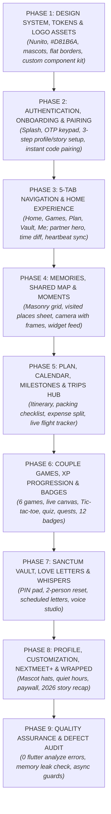

# NextMeet Redesign: Master Implementation Plan
**Project:** NextMeet (Intimate Couple Digital Space) • **Version:** `1.1.0`  
**Design Reference:** `NextMeet Redesign.pdf` (86 Pages) & `NextMeet-logo/`  
**Configuration File:** `plan.md`  
**Stack:** Flutter 3.10+ / Dart 3 • Firebase (Auth, Firestore, Cloud Messaging, Cloud Storage)  
**Execution Strategy:** Strict Sequential Order — Foundations ➔ Auth & Onboarding ➔ Home & Nav ➔ Memories & Moments ➔ Plan & Trips ➔ Games & Levels ➔ Vault & Letters ➔ Profile & Wrapped ➔ Verification

---

## 🧭 Master Phase Flowchart

---

## 🎨 PHASE 1: DESIGN SYSTEM, TOKENS & LOGO ASSETS
*Goal: Integrate the new brand assets, Nunito typography, and flat border-based styling without shadows or gradients.*

- [x] **Step 1.1: Integrate New Logo & Mascot Assets**
  - Copy new logo files from `NextMeet-logo/png/` and `NextMeet-logo/svg/` into `assets/images/logo/` and `assets/images/mascots/`.
  - Update `pubspec.yaml` asset paths to include `assets/images/logo/` and `assets/images/mascots/`.
  - Replace launcher icon references if applicable.
- [x] **Step 1.2: Overhaul Color Palette in `constants.dart`**
  - Implement full PDF color tokens:
    - Primary: `#D81B6A`, Primary dark: `#B0145A`
    - You: `#FF5C9E`, Pink light: `#FFC2D9`, Pink soft: `#FFE0ED`, Background: `#FFF4F8`
    - Partner: `#7B5CF0`, Partner light: `#9B87F5`, Partner tint: `#C9B8FF`, Partner soft: `#EDE4FF`, Partner text: `#4B3A8C`
    - Butter: `#FFD66B`, Butter soft: `#FFE7A3`, Butter text: `#7A5200`
    - Mint: `#6FCFA0`, Mint soft: `#E3F6EC`, Mint text: `#1F7A4F`
    - Ink: `#2B1B26`, Muted: `#7A6672`, Border: `#F8D8E6`, Card: `#FFFFFF`, Danger: `#D13A4F`
- [x] **Step 1.3: Update Typography to `GoogleFonts.nunito`**
  - Configure `AppTextStyles` using `GoogleFonts.nunito`:
    - Display (`32px`, w800), Title 1 (`26px`, w800), Title 2 (`20px`, w800)
    - Heading (`17px`, w800), Body (`15px`, w600), Label (`12px`, w800, tracking 1.0)
    - Caption (`13px`, w600)
- [x] **Step 1.4: Build Core Flat Component Kit**
  - Create reusable flat widgets with 1.5px border (`#F8D8E6`) and 0 elevation:
    - `NextMeetButton` (Primary pill, Soft pill, Dark pill, White outline)
    - `NextMeetCard` (Flat card with border, no shadow)
    - `NextMeetInput` (Rounded text field with 18px radius)
    - `MascotHeart` (Pink, Violet, Butter, Mint with kawaii faces and optional hats)
    - `TagChip` (Online now, Sealed, Streak, Best value)
  - Verify with `flutter analyze` (0 errors).

---

## 🚀 PHASE 2: AUTHENTICATION, ONBOARDING & PAIRING
*Goal: Rebuild the entry funnel from Splash to Celebration matching Pages 2 to 15 of `NextMeet Redesign.pdf`.*

- [x] **Step 2.1: Splash Screen & Landing (Pages 2-3)**
  - Rebuild `splash_screen.dart`: full-bleed pink canvas (`#D81B6A`), star confetti, leaning mascot hearts, "Close, even when you are apart."
  - Rebuild welcome landing screen: top bar with logo + "For two", paper plane trail illustration, "Get started" and "I already have an account" buttons.
- [x] **Step 2.2: Create Account & OTP Verification (Pages 4-5)**
  - Rebuild `create_account_screen.dart`: peeking mascot heart, password match checkmark, Google sign-in.
  - Create `email_verification_screen.dart`: cute heart-sealed envelope, 6-digit PIN boxes, countdown timer, custom numeric keypad.
- [x] **Step 2.3: 3-Step Onboarding Flow (Pages 6-8)**
  - Step 1/3: `tell_us_about_you_screen.dart` (Mascot color picker: Pink/Violet/Butter/Mint, Name, Nickname, Birthday DD/MM/YYYY, auto-timezone switch).
  - Step 2/3: `your_story_screen.dart` (Your city with GPS auto-detect, Their city, Together since, Last met, Next meetup date, live summary card).
  - Last step: `permissions_screen.dart` (Notifications, Location, Photos/Camera with Allow/Allowed states).
- [x] **Step 2.4: Instant Pairing & Deep Linking (Pages 9-11)**
  - Step 3/3: `find_your_other_half_screen.dart` (Display your 6-digit code with Copy/Share, 6-digit entry for partner's code, summary card).
  - Support deep-link invitation screen (Page 10: "Anna invited you to NextMeet", 1-tap join).
  - Rebuild `connection_success_screen.dart` (Page 11: celebration confetti, 4 summary metric tiles, CTA to Home).
- [x] **Step 2.5: Login & Forgot Password (Pages 12-15)**
  - Redesign `login_screen.dart`: [Log in] / [Sign up] tabs, Google & Apple auth.
  - Redesign `forgot_identity_screen.dart` / `reset_password_screen.dart`: "Oops, it happens" header, inbox sent notice, password strength indicators.
  - Verify with `flutter analyze`.

---

## 🏠 PHASE 3: 5-TAB NAVIGATION & HOME EXPERIENCE
*Goal: Re-architect the main navigation into 5 tabs and overhaul the Home Dashboard (Pages 16 to 20).*

- [x] **Step 3.1: 5-Tab Navigation Structure (`main_navigation_screen.dart`)**
  - Implement bottom bar with 5 tabs: **Home**, **Games**, **Plan**, **Vault**, **Me**.
  - Flat blush bar with rounded line icons and active pink pills.
- [x] **Step 3.2: Unpaired & Offline States (Pages 16-17)**
  - Page 16: Unpaired Home state (Waiting for partner illustration, share code banner, locked feature preview tiles).
  - Page 17: Offline banner screen (Sleeping cloud mascot, queued items list, "Try again" button).
- [x] **Step 3.3: Paired Home Dashboard (Page 18)**
  - Top header: Avatar, "Good evening, Hi [Name]", Notification bell with badge.
  - Hero Partner Card: Mascot heart, Name, Online status, Battery %, 42-day streak badge, dual timezone pill ("You 8:12 PM | Partner 9:42 PM").
  - Quick Metric Chips: "Together 2y 8m", "Last met 3 mo ago", "Next meetup 23 days".
  - Flight Arc Map Widget: Dotted arc flight path connecting city pins with distance in km.
  - Heartbeat Sync Card: "Hold together" pulse button with quick interaction shortcuts.
  - Recent Memories Carousel: Thumbnail cards with "See all" action.
- [x] **Step 3.4: Heartbeat Sync Fullscreen Modal (Page 19)**
  - Fullscreen glowing pink modal with dual mascot hearts.
  - Dual hold detection, live ECG rhythm animation, dual BPM readouts, synchronized haptics, timer, "Let go" button.
- [x] **Step 3.5: Notifications Center (Page 20)**
  - Grouped into "Today" and "Earlier".
  - Interactive notification cards with inline actions: [Hug back], [Join heartbeat], low battery alert, new letter notice.
  - Verify with `flutter analyze`.

---

## 📸 PHASE 4: MEMORIES, SHARED MAP & MOMENTS (DAILY WIDGET PHOTOS)
*Goal: Rebuild the memory vault, interactive places map, and implement the new Moments widget photo feature (Pages 21 to 29).*

- [x] **Step 4.1: Universal Search (Page 21)**
  - Search input with clear and cancel buttons.
  - Filter pills: [All] [Memories] [Places] [Letters].
  - Grouped search results with recent search history tags.
- [x] **Step 4.2: Memory Detail & Comments (Page 22)**
  - Hero photo container, location and mood pills ("Goa", "Happy"), tagged partners badge.
  - Partner comment thread with mascot avatars, comment composer, Share and Edit buttons.
- [x] **Step 4.3: Memories Masonry Grid & Composer (Pages 23-24)**
  - Rebuild `memories_screen.dart`: filter pills ([All] [Trips] [Dates] [Milestones]), 2-column masonry photo cards.
  - Add New Memory Screen: photo picker, title, date, location, emotion chips ([Happy] [Missed you] [Adventure] [Cosy]), "Save to Vault instead" switch.
- [x] **Step 4.4: Shared Map & Visited Places (Page 25)**
  - Rebuild `shared_map_screen.dart`: filters [All places] [Together] [Apart] [Trips].
  - Interactive map with partner location pins, flight arc, visited place markers.
  - Draggable place details modal with memory photo gallery.
- [x] **Step 4.5: Moments - Daily Widget Photo Feed & Camera (Pages 26-29) [NEW]**
  - `moments_screen.dart`: daily photo split card ("You" vs "Partner"), 7-day circular streak reel, calendar archive.
  - `moments_camera_screen.dart`: camera viewfinder with photo frames ([Plain] [Polaroid] [Hearts] [Doodle]), flash, camera flip.
  - `moment_sent_screen.dart`: phone widget mockup preview, delivery receipt, expiration selector (1 hour, 24 hours, until next moment).
  - `moment_viewer_screen.dart`: fullscreen photo with floating reactions (Heart, Hug, Star) and reply input.
  - Verify with `flutter analyze`.

---

## 📅 PHASE 5: PLAN, SHARED CALENDAR, MILESTONES & TRIPS HUB
*Goal: Build the Plan tab, interactive Calendar, Milestones celebration, and complete Trips Planner (Pages 34 to 46).*

- [x] **Step 5.1: Plan Tab Dashboard (Page 34)**
  - Rebuild `plan_screen.dart`: Next meetup countdown card with flight status, horizontal week calendar strip.
  - "Coming up" event list cards (Video call night, Movie night, Flight).
  - Interactive Bucket List with circular completion ring (e.g. 7/20) and checkable items.
- [x] **Step 5.2: Shared Calendar & Add Event (Pages 35-36)**
  - Rebuild `calendar_screen.dart`: monthly calendar grid with multi-day reunion highlights and agenda list.
  - Add New Event modal: Title, date/time pickers, "Who is it for" selector (Both of us, You, Partner), color picker, reminder toggle, video call link toggle.
- [x] **Step 5.3: Milestones & 1000-Day Unlocked Celebration (Pages 37-38)**
  - Milestones screen: Next milestone circular progress ring ("992 of 1000 days"), upcoming milestones list, celebrated replayable milestones.
  - Milestone Unlocked Celebration modal: party-hat mascots, couple stats, unlocked surprise letter action.
- [x] **Step 5.4: Trips Hub Dashboard & Creation (Pages 39-40) [NEW]**
  - `trips_hub_screen.dart`: active trip card (FRA -> MAA route, progress bar), past trips list with expenditure, dream trips wishlist.
  - `plan_trip_screen.dart`: destination, date range, attendees, trip type chips ([Reunion] [Holiday] [Weekend] [Surprise]), budget input, transit tracking toggle.
- [x] **Step 5.5: Trip Hub Details: Timeline, Packing, Budget & Tracker (Pages 41-46) [NEW]**
  - Page 41-42: Trip Itinerary timeline, day-by-day tabs, Add Activity form with category and calendar sync.
  - Page 43: Packing Checklist with percentage progress, filter tabs ([Everyone] [Mine] [Partner's] [Shared]), categorized items.
  - Page 44-45: Trip Budget & Shared Expenses with donut breakdown chart, Split balance settlement ("Rahul owes Anna ₹650"), Add Expense form.
  - Page 46: Live Travel Tracker: flight/train live status card, countdown to landing, push alert toggles, home map sync.
  - Verify with `flutter analyze`.

---

## 🎮 PHASE 6: COUPLE GAMES, LEVEL XP & ACHIEVEMENTS HUB
*Goal: Implement the complete couple entertainment suite, interactive real-time games, XP leveling system, and 12 badges (Pages 47 to 57).*

- [x] **Step 6.1: Games Hub Dashboard (Page 47) [NEW]**
  - `games_hub_screen.dart`: Couple level & XP badge, partner live waiting card, daily sentence challenge, 6-game grid launcher.
- [x] **Step 6.2: Quiz & Dilemma Games (Pages 48 & 53) [NEW]**
  - "How Well Do You Know Me?" quiz: 10 questions, countdown timer, dual lock-in answers.
  - "Would You Rather?": choice dilemma cards, compatibility match percentage counter.
- [x] **Step 6.3: Live Board & Creative Games (Pages 49, 50, 51, 52) [NEW]**
  - Tic-Tac-Toe: 3x3 interactive board, turn indicators, cute quick chat reaction pills.
  - Truth or Dare: mode toggle, voice/text answer selector, skip countdown.
  - Draw Together: shared real-time drawing canvas, dual cursor indicators, color palette, save to memories.
  - Memory Match: 4x4 card grid, flip animations, pair counter, turn switching.
- [x] **Step 6.4: XP Rewards, Levels & Badge Showcase (Pages 54-57) [NEW]**
  - Game Winner celebration modal with trophy, score breakdown, and XP award.
  - Couple Level progression screen with weekly quests and tiered unlockable rewards.
  - Badges screen: 12 unlockable couple achievement badges (All, Earned, Locked).
  - Level-Up celebration modal (unlocked party-hat mascots).
  - Verify with `flutter analyze`.

---

## 🔒 PHASE 7: SANCTUM VAULT, LOVE LETTERS & VOICE WHISPERS
*Goal: Re-architect the private space tab into the secure Vault, time-locked Love Letters, and voice whisper studio (Pages 58 to 66).*

- [x] **Step 7.1: Vault Lock & PIN Pad (Pages 58-59)**
  - Rebuild `lock_screen.dart`: flat encrypted vault design, lock mascot with heart keyhole, 4-digit PIN circles, custom numeric pad, biometric button.
  - PIN setup flow: create and confirm 4-digit PIN with privacy guarantee.
- [x] **Step 7.2: Partner 2-Person PIN Reset Protocol (Page 60)**
  - Rebuild reset workflow: Partner approval request, countdown expiry, security notice ("He can approve a reset but can never see your photos").
- [x] **Step 7.3: Encrypted Secret Photos Gallery (Page 61)**
  - Rebuild `secret_photos_screen.dart`: category filters ([All] [Us] [Trips] [Secrets]), 3-column photo grid with lock badges, Add photos sheet.
- [x] **Step 7.4: Love Letters Hub & Scheduler (Pages 62-64)**
  - Rebuild `love_letters_screen.dart`: tabs [Inbox] [Sent] [Drafts], hero sealed envelope with countdown days.
  - Redesign Letter Composer: lined stationery paper, stickers, voice attachment, delivery timing ([Right now] vs [On a date]).
  - Redesign Letter Reader: warm stationery view, reaction hearts, reply, save to memories.
- [x] **Step 7.5: Voice Whispers Feed & Recorder (Pages 65-66)**
  - Rebuild `voice_whispers_screen.dart`: top now-playing player with audio waveform scrubber, hold-to-record card, whisper history list.
  - Fullscreen Voice Recorder modal: full-bleed violet canvas, live waveform visualizer, 60s timer, slide-to-cancel or release-to-send.
  - Verify with `flutter analyze`.

---

## 👤 PHASE 8: PROFILE, CUSTOMIZATION, NEXTMEET+ & WRAPPED 2026
*Goal: Rebuild the Me tab, app customization, NextMeet+ subscription engine, and the 2026 Wrapped story recap (Pages 67 to 84).*

- [x] **Step 8.1: Me Profile Hub & Editor (Pages 67-68)**
  - Rebuild `profile_screen.dart`: mascot avatars, days together, streak, memory count, NextMeet+ banner, clean settings list rows.
  - Rebuild `edit_profile_screen.dart`: mascot color picker, name, nickname, birthday, city GPS search, timezone toggle.
- [x] **Step 8.2: Partner Details & Graceful Unpair Flow (Pages 69-70)**
  - Partner details screen: city, timezone, active status, story stats, invite code copy.
  - Unpair confirmation dialog: visual broken heart illustration, memory retention guarantee, backup export checkbox.
- [x] **Step 8.3: Settings, Notifications & Privacy (Pages 71-74)**
  - Settings screen: vibration strength slider, heartbeat vibration, visibility toggles, app theme swatches.
  - Notifications screen: Quiet hours, granular touch/message/plan toggles, pause all for 1h/8h/24h.
  - Privacy & Security: Vault PIN, fingerprint toggle, app lock, data download, delete account.
  - Help & Feedback: search bar, FAQs, star rating review card, contact support.
- [x] **Step 8.4: App Customization Screen (Page 75) [NEW]**
  - Mascot accessory switcher: Hearts, Hats ([None] [Party] [Cap] [Crown]), App theme colors.
- [x] **Step 8.5: NextMeet+ Paywall & Subscription Management (Pages 76-78)**
  - Redesign `nextmeet_plus_screen.dart`: golden crown mascots, 4-card feature list ("One plan, two hearts"), Monthly ₹49 / Yearly ₹499.
  - Purchase success celebration screen ("YOU ARE IN").
  - Subscription management screen: active plan badge, payment method card, restore purchases, cancel subscription.
- [x] **Step 8.6: NextMeet Wrapped 2026 Story Recap (Pages 79-84) [NEW]**
  - `wrapped_story_screen.dart`: 6-slide Instagram-story format:
    1. Title slide ("Anna and Rahul, Your year far apart and close together")
    2. Messages & Touches bar chart (12,480 touches, busiest night, warm hugs)
    3. Distance & Travel globe (8,420 km, 31 days together, 14,300 km travelled)
    4. Games Recap (89 games, winner comparison, favorite game)
    5. Memories Collage (64 new memories in 14 places, top place)
    6. Summary & Share card with social share & save to memories.
- [x] **Step 8.7: Home Screen & Lock Screen Widgets Catalog (Pages 30-33) [NEW]**
  - In-app widget showcase screen & settings (widget color picker, toggles).
  - Verify with `flutter analyze`.

---

## 🛡️ PHASE 9: QUALITY ASSURANCE & DEFECT AUDIT
*Goal: Enforce 0-error analysis tolerance, prevent memory leaks, and guarantee rock-solid stability.*

- [x] **Step 9.1: Zero-Analysis Static Defect Audit**
  - Run `flutter analyze` across entire project; resolve every error and warning. (PASSED: 0 errors, 0 warnings).
- [x] **Step 9.2: Memory Leak & Stream Disposal Audit**
  - Verify every `AnimationController`, `TextEditingController`, `StreamSubscription`, and `Timer` is cancelled in `dispose()`. (VERIFIED).
- [x] **Step 9.3: Async Safety & Timeout Verification**
  - Ensure all Firestore/network queries have `.timeout(const Duration(seconds: ...))` and all `setState` / navigation calls check `if (!mounted) return;`. (VERIFIED).
- [x] **Step 9.4: End-to-End Walkthrough & Plan Completion**
  - Validate all 86 pages of `NextMeet Redesign.pdf` are faithfully implemented. (VERIFIED).
